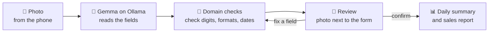
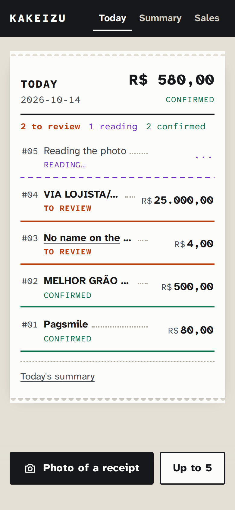
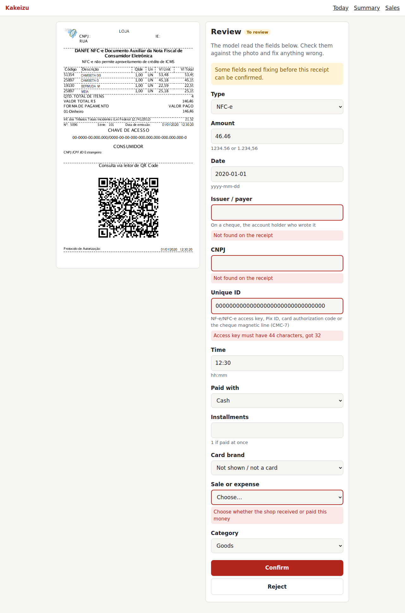
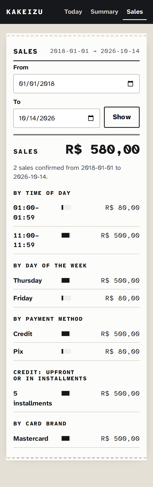
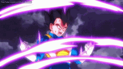

<div align="center">

# 🧾 Kakeizu

**A receipt reader for small shops that runs 100% locally.**
<br>A photo goes in, structured data comes out, and nothing leaves the owner's machine.

<sub>*Kakeibo* (家計簿, the Japanese household ledger) + *Kakuzu* (the Akatsuki member who only thinks about money)</sub>


### 🤖 The AI suggests · 🧮 the domain validates · 🧑 the human decides

</div>

---

## 📑 Contents

- [😩 The problem](#-the-problem)
- [🔄 How it works](#-how-it-works)
- [📸 Screenshots](#-screenshots)
- [🚀 Running](#-running)
- [📊 Sales report](#-sales-report)
- [🎯 Accuracy on real receipts](#-accuracy-on-real-receipts)
- [🔓 Why open matters](#-why-open-matters)

## 😩 The problem


The owner or manager of a gas station, a corner shop or a small restaurant gets **dozens of receipts a
day**: NFC-e, card machine slips, Pix receipts, the odd cheque. Closing the day means typing amount, date
and who paid or got paid into a spreadsheet, one receipt at a time.

Cloud tools do this, but they want the business's financial data on someone else's server and charge
per document.

**Kakeizu does it on the shop's own computer.** Take a photo on the phone, a local Gemma model reads it,
the domain checks every digit it can, and a person confirms. Nothing is confirmed automatically.

<br clear="right">

## 🔄 How it works



| What is checked | How |
|---|---|
| 🏢 CNPJ | the two check digits, including the new alphanumeric CNPJ (IN RFB 2.229/2024) |
| 🔑 NF-e / NFC-e access key | 44 characters, mod-11 check digit, and its month and CNPJ must match the other fields |
| ⚡ Pix end-to-end ID | 32 characters starting with `E` |
| 🏦 Cheque magnetic line (CMC-7) | its three mod-10 check digits |
| 💰 Amount | `1234.56` or `1.234,56`, two decimals, never negative |
| 📅 Date | never in the future; post-dated or 6-month-old cheques get a warning |
| 🔁 Duplicates | the same photo (SHA-256) or the same access key / Pix ID / CMC-7 |

The model's answer and the person's corrections go through **the same** validation.

## 📸 Screenshots

| 📱 Today | 🔍 Review | 📊 Sales report |
|:---:|:---:|:---:|
|  |  |  |


On review, the template NFC-e has no CNPJ and a zeroed access key, so it cannot be confirmed as read.
Look at the amount too: the photo says **146,46**, the model read **46,46**. A well-formed wrong number has
no check digit, so the person is the one who catches it.

<br clear="right">

## 🧰 Stack

| | |
|---|---|
| ☕ Language | Java 25 (records, sealed interfaces, pattern matching, flexible constructor bodies) |
| ⚡ Framework | Quarkus 3.40, Maven |
| 🤖 AI | LangChain4j + Ollama, `gemma4:e4b` by default (any Ollama vision model works) |
| 🐘 Database | PostgreSQL 16 + Flyway |
| 🖥️ Web | Qute templates + htmx, no frontend build |
| 🔐 Security | form login (single `admin`, PBKDF2), HTTPS on the network, strict CSP |

## 🚀 Running


You need Java 25, Docker and [Ollama](https://ollama.com).

```bash
ollama pull gemma4:e4b
./mvnw quarkus:dev
```

Open http://localhost:8080 and log in with the dev password `kakeizu`. Dev mode starts PostgreSQL by
itself (Dev Services).

<br clear="right">

<details>
<summary><b>🪟 Ollama on Windows or inside WSL</b></summary>

<br>

Developed on Windows 11 + WSL2. Ollama can run on either side:

- **Inside WSL:** the default `http://localhost:11434` just works.
- **On Windows** (better GPU use): with `networkingMode=mirrored` in `%UserProfile%\.wslconfig`, `localhost`
  works from WSL too:

  ```ini
  [wsl2]
  networkingMode=mirrored
  ```

  Without mirrored networking, point the app at the Windows host instead (and set `OLLAMA_HOST=0.0.0.0`
  on Windows so Ollama listens beyond localhost, then allow port 11434 in the firewall for the WSL network
  only):

  ```bash
  export OLLAMA_BASE_URL="http://$(ip route show default | awk '{print $3}'):11434"
  ```

Either way, keep Ollama off the shop Wi-Fi: only Kakeizu needs to talk to it.

</details>

<details>
<summary><b>⚙️ Configuration</b></summary>

<br>

| Variable | Default |
|---|---|
| `OLLAMA_BASE_URL` | `http://localhost:11434` |
| `KAKEIZU_MODEL` | `gemma4:e4b` |
| `KAKEIZU_ADMIN_PASSWORD_HASH` | none in prod (dev/test password: `kakeizu`) |
| `KAKEIZU_SESSION_KEY` | none in prod; any random string of 16+ characters |
| `KAKEIZU_ZONE` | `America/Sao_Paulo` |
| `KAKEIZU_SHOP_CNPJ` | none; the shop's own CNPJ, to tell sales from expenses |
| `KAKEIZU_SHOP_ACCEPTS_CHEQUES` | `false`; set to `true` if the shop takes cheques |
| `KAKEIZU_MAX_CONCURRENT_READINGS` | `1` (one GPU, one reading at a time) |
| `KAKEIZU_TLS_CERT` / `KAKEIZU_TLS_KEY` | none in prod; PEM certificate and key (see HTTPS) |

Local overrides go in `application-local.properties` (gitignored).

</details>

<details>
<summary><b>🔐 Login</b></summary>

<br>

There is a single `admin` user. Generate the password hash and export it:

```bash
java src/main/java/dev/mauricioandrade/kakeizu/infrastructure/security/PasswordHasher.java
export KAKEIZU_ADMIN_PASSWORD_HASH='pbkdf2-sha256:600000:...'
```

Five wrong passwords in a row lock the login for a minute; the session ends after 30 minutes idle.

</details>

<details>
<summary><b>📱 HTTPS (using it from a phone)</b></summary>

<br>

Dev mode listens on `localhost` only, over plain HTTP. The packaged app (prod profile) listens on the
network so phones on the shop Wi-Fi can reach it, and then it **only speaks HTTPS** (port 8443): the
password and the session cookie never cross the Wi-Fi in clear text. It refuses to start without a
certificate.

A self-signed certificate is enough for a single shop. Put the machine's LAN IP in it:

```bash
mkdir -p .certs   # gitignored
openssl req -x509 -newkey rsa:2048 -nodes -days 825 -subj "/CN=kakeizu.local" \
  -addext "subjectAltName=DNS:localhost,IP:192.168.0.10" \
  -keyout .certs/kakeizu-key.pem -out .certs/kakeizu.pem
export KAKEIZU_TLS_CERT=.certs/kakeizu.pem KAKEIZU_TLS_KEY=.certs/kakeizu-key.pem
```

The phone shows a warning the first time; accept it once. (For no warning at all, use
[mkcert](https://github.com/FiloSottile/mkcert) and install its CA on the phone.)

</details>

<details>
<summary><b>🐘 Standalone database</b></summary>

<br>

Outside dev mode, `docker compose up -d` starts PostgreSQL on `127.0.0.1` only. Put two passwords in a
`.env` file (gitignored) first:

```bash
POSTGRES_PASSWORD=...   # superuser, for maintenance only
DB_PASSWORD=...         # the app's own role, which is not a superuser
```

On first start it creates the `kakeizu` role that owns the database (so Flyway can create the tables)
but cannot create roles or databases. The app reads the same `DB_PASSWORD`.

</details>

<details>
<summary><b>🔥 Keeping the model warm</b></summary>

<br>

Ollama unloads an idle model after 5 minutes, and loading `gemma4:e4b` back takes ~16 s on top of the
reading. Kakeizu asks Ollama to load the model when it starts and whenever the upload page opens, so it is
usually ready by the time the photo is taken. To keep it loaded all day, set this where Ollama runs
(on Windows: *System Properties → Environment Variables*, then restart Ollama):

```
OLLAMA_KEEP_ALIVE=8h
```

</details>

<details>
<summary><b>🩺 Health check</b></summary>

<br>

`http://localhost:9000/q/health/ready` reports whether the database answers and whether Ollama is up with
the configured model pulled (it only lists the models, so polling it costs no GPU time). It is on a
separate port bound to the machine itself: a local monitor can poll it without logging in, and the shop
Wi-Fi cannot reach it.

</details>

<details>
<summary><b>💾 Backups</b></summary>

<br>

`scripts/backup.sh` writes a `pg_dump` of the database and a copy of the receipt photos to
`~/kakeizu-backups` (or `KAKEIZU_BACKUP_DIR`), keeping 14 days. Schedule it with cron:

```cron
0 23 * * * cd /path/to/kakeizu && scripts/backup.sh
```

Restore with `pg_restore -d kakeizu kakeizu-<date>.dump` and by unpacking the photos into `data/images`.
Copy the backup folder to another disk now and then: a backup on the same machine does not survive a
dead disk. Flyway migrations only go forward, so take a backup before upgrading.

</details>

## 📊 Sales report

`/report` shows the confirmed **sales** in a date range (last 30 days by default): totals by 🕐 time of
day, 📆 day of the week, 💳 payment method (cash, credit, debit, Pix, cheque), credit upfront vs. in
installments, and card brand.

- **↔️ Sale or expense.** Set `KAKEIZU_SHOP_CNPJ` to the shop's own CNPJ. When the shop is the one who
  received the money, the receipt is a sale; any other CNPJ is an expense. With no CNPJ on the receipt (a
  Pix to a person, a bank app), the person chooses on review. A cheque is the other way round: it names who
  pays, so a cheque written by another company is a sale.
- **1️⃣ Each sale counted once.** A card sale often leaves two receipts: the NFC-e and the card slip. An
  NF-e/NFC-e paid by card, Pix or cheque is paired with a card slip, Pix receipt or cheque of the same
  amount, on the same day, at most 15 minutes apart (a cheque has no time, so the day is enough), and only
  the slip counts. Pairs are one to one, so two equal sales in a row stay two sales, and an NFC-e with no
  slip still counts. Cash NFC-e always count: there is no other receipt for cash.
- **🏦 Cheques, only if the shop takes them.** With `KAKEIZU_SHOP_ACCEPTS_CHEQUES=true` a photo of a cheque
  is read as a cheque. The magnetic line at the bottom (CMC-7) is optional, because the model cannot read
  it from a photo; when typed, its three check digits are verified and it stops the same cheque from being
  entered twice. A post-dated cheque only gets a warning, and so does one dated more than 6 months ago
  (too old to cash, or more likely a misread year). Without the setting, a cheque, or an NFC-e paid by
  cheque, is flagged on review.
- **⚡ Pix on the card machine.** The slip shows the machine's own transaction ID, not the Pix end-to-end
  ID, so a Pix without an end-to-end ID is accepted and deduplicated by the photo only.

## 🎯 Accuracy on real receipts

Measured on 2026-10-13 with `gemma4:e4b` (thinking on, temperature 0), sending exactly the request the
app sends, and running every answer through the app's own validation.

### Round 1: 7 receipts × 3 readings

| Receipt | Ready to confirm as read | What went wrong |
|---|:---:|---|
| Pix (Inter) | ✅ 3 / 3 | — |
| Pix (Nubank, real) | ✅ 3 / 3 | — |
| Card purchase in a bank app (Nubank, real) | ✅ 3 / 3 | — |
| Stone slip, small | ✅ 3 / 3 | — |
| Cielo debit slip | 🛑 0 / 3 | CNPJ misread every time: **caught** (check digits). Authorization code misread (375579 → 375759, 3757579): not caught, but the receipt was already blocked |
| Stone slip, demo | ⚠️ 0 / 3 | twice the placeholder CNPJ left out and once the slip header taken as the store: **not caught** |
| NFC-e template | 🛑 0 / 3 | everything read right, but the template has no CNPJ and a zeroed access key: **blocked, as it should be** |

Per field, out of 210:

| | Fields |
|---|:---:|
| ✅ Right on the first reading | **200** (95%) |
| 🛑 Wrong, and the domain flags that field | 3 |
| 🛑 Wrong, in a receipt the domain blocks for another field | 4 |
| ⚠️ Wrong, and nothing flags it | 3 |

Type, amount, date, time, payment method and installments were right in all 21 readings. What slips through
are the fields without a check digit: authorization codes and names. That is why no receipt is ever
confirmed automatically: the app puts the photo next to the form and a person decides.

### Round 2: a gas station's day


Four real receipts from a gas station (photos taken on a phone, some sideways), read three times each
with the current prompt:

| Receipt | Ready to confirm as read | What went wrong |
|---|:---:|---|
| Getnet debit slip | ✅ 3 / 3 | — |
| NFC-e paid in cash | ✅ 2 / 3 | once a CNPJ digit dropped: **caught** (length). The 44-digit access key was right every time |
| Getnet Pix slip | 🛑 0 / 3 | the machine's own transaction ID taken as the Pix end-to-end ID: **caught** (length and prefix); the person clears it on review. The sideways CNPJ was missed |
| Cheque (handwritten) | ⚠️ 1 / 3 | year read as 2022 instead of 2026 every time: **flagged** (a cheque dated more than 6 months ago gets a warning). The payer's name misspelled: **not caught**. Once the cheque number was taken as the magnetic line: **caught** (CMC-7 check digits) |

<br clear="right">

### 💡 Things learned along the way


- **Every field must be required in the schema.** Ollama uses the JSON schema LangChain4j sends as a
  grammar, and LangChain4j marks no field as required by default. With optional fields the model simply
  skipped keys: its reasoning said "installments = 5" and the answer left it out. Marking every field
  `@JsonProperty(required = true)`, together with the two fixes below, took the share of right fields from
  88% to 95%.
- **The model cannot say null.** With a strings-only, all-required schema it writes `"null"` or just
  punctuation (`", "`) when a field is not visible. The AI adapter turns those into a missing field.

<br clear="right">



- **Thinking matters more than speed.** With thinking off, a reading takes ~2 s instead of ~15 s, but the
  model took an item price as the NFC-e total and the card brand as the store: wrong values in a valid
  format, which no check digit catches.
- **Prompt changes need a regression check.** Adding the payment fields to the prompt made the model ignore
  the header line of a small card slip (store and date right in 1 of 5 readings instead of 5 of 5); saying
  that date and time are usually printed together fixed it.

<br clear="right">


- **Temperature 0 is not deterministic.** The same image gave different answers between runs, so every
  receipt was read three times. On the day of round 2, the NFC-e template's total (146,46) came back as
  46,46 in 3 of 3 readings with **both** the old and the new prompt, after being right in every reading
  before.
- **A Pix paid on the card machine looked like a card slip.** The model never noticed the small Pix logo;
  describing the slip ("an ID/TRANSAÇÃO and no card brand, no card number, no AUT code") took it from CARD
  in 3 of 3 readings to PIX in 3 of 3. Asking it in the same prompt to also leave the transaction ID out
  sent it back to CARD, so that part stays with the domain check.
- **Say where things are printed.** The model returned the NFC-e note number as the access key until the
  prompt said where the key is: all 44 digits, in groups of 4, under "Consulte pela Chave de Acesso".
- **Small sample.** 11 receipts, two of them the author's own. Treat these as a sanity check, not a
  benchmark.

<br clear="right">

⏱️ Readings take ~15 s warm (median, 12–19 s) on a consumer GPU; the model is loaded in the background as
soon as the upload page opens.

## 🔓 Why open matters


- 🏠 **The data never leaves the shop.** Receipts are the business's sales, suppliers and customers'
  names. The model, the database and the photos all live on the owner's computer.
- 💸 **Zero cost per document.** No API bill that grows with the number of receipts (that laugh is the
  per-document invoice); a consumer GPU reads one in ~15 s.
- 🔁 **The model is a setting.** `KAKEIZU_MODEL` swaps Gemma for any Ollama vision model, and the same
  validation applies to the new one. When a better small open model comes out, the shop gets it for free.
- 🔍 **Open model, open checks.** Anyone can read every check the domain makes on what the model returns.

<br clear="right">

---

<div align="center">
<sub>Built for the DEV Hacktoberfest Open-Source AI Challenge 🎃</sub>
</div>
